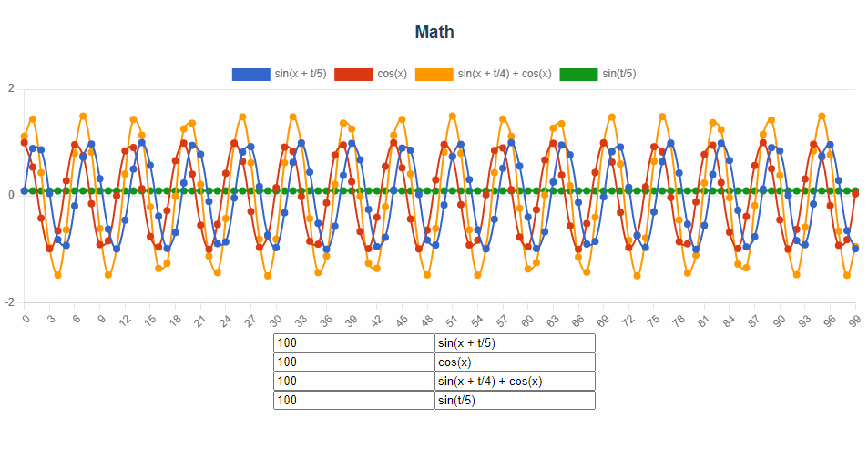

# Math Visualization Library

Библиотека для простой и наглядной визуализации математических концепций.



## 🚀 Возможности

### Графики функций
- ✅ Визуализация функций одной переменной (2D графики)
- ✅ Анимация функций с параметром времени `t`
- ✅ Вычисление производных и интегралов
- ✅ Композиция функций (функции могут использовать значения других функций)
- ✅ Полярные и параметрические координаты
- ✅ Интерактивное управление: play/pause, добавление/удаление функций
- ✅ Сохранение и загрузка конфигураций
- ✅ Темная/светлая тема
- ✅ Экспорт в PNG
- ✅ История изменений (undo/redo)

### Школьная математика (5-9 класс) 🆕
- ✅ **Числовая прямая** - визуализация точек на числовой оси
- ✅ **Операции с дробями** - наглядное представление дробей и операций с ними
- ✅ **Проценты** - круговые диаграммы для визуализации процентов
- ✅ **Пропорции и масштаб** - визуальное сравнение пропорциональных величин
- ✅ **Системы линейных уравнений** - графическое решение систем двух уравнений
- ✅ **Неравенства** - отображение решений неравенств на числовой прямой
- ✅ **Модуль числа |x|** - график функции с модулем
- ✅ **Квадратные уравнения** - парабола, дискриминант, визуализация корней

### Геометрия (планиметрия) 🆕
- ✅ **Примитивы** - точки, прямые, отрезки, лучи
- ✅ **Углы** - визуализация градусов и радианов, типы углов
- ✅ **Треугольники** - виды треугольников, теорема Пифагора, площадь
- ✅ **Четырёхугольники** - квадрат, прямоугольник, ромб, параллелограмм, трапеция
- ✅ **Окружность и круг** - радиус, диаметр, хорда, центральный и вписанный углы
- ✅ **Многоугольники** - правильные многоугольники (3-12 сторон)
- ✅ **Векторы** - сложение, умножение на скаляр, скалярное произведение
- ✅ **Преобразования плоскости** - параллельный перенос, поворот, симметрия, гомотетия

### Стереометрия (3D геометрия) 🆕
- ✅ **3D визуализация** - интерактивная 3D графика с Three.js и WebGL
- ✅ **Координаты в пространстве** - визуализация точек, расстояния, проекции на плоскости
- ✅ **Векторы в пространстве** - сложение векторов, скалярное произведение, углы между векторами
- ✅ **Прямые и плоскости** - уравнения плоскостей, нормали, взаимное расположение
- ✅ **Многогранники**:
  - Куб и параллелепипед (объёмы и площади поверхностей)
  - Призма (правильная шестиугольная)
  - Пирамида (объём и площадь)
  - Платоновы тела (тетраэдр, октаэдр, додекаэдр, икосаэдр)
- ✅ **Тела вращения**:
  - Цилиндр (объём, площадь боковой и полной поверхности)
  - Конус (объём, образующая, площадь боковой поверхности)
  - Шар и сфера (объём и площадь поверхности)
- ✅ **Сечения многогранников** - интерактивное сечение плоскостью

### Тригонометрия (9-11 класс) 🆕
- ✅ **Единичная окружность** - визуализация sin, cos, tg, ctg на единичной окружности
- ✅ **Тригонометрический круг** - квадранты, знаки функций, особые углы
- ✅ **Графики функций** - sin(x), cos(x), tg(x), ctg(x), arcsin, arccos, arctg
- ✅ **Преобразования функций** - амплитуда, период, фаза (y = A·sin(B·x + C) + D)
- ✅ **Тригонометрические уравнения** - визуализация решений уравнений sin(x)=a, cos(x)=a, tg(x)=a

## 📦 Установка

```bash
npm install
```

## 🛠️ Использование

### Запуск в режиме разработки

```bash
npm run dev
```

### Сборка для production

```bash
npm run build
```

### Линтинг

```bash
npm run lint
```

## 📚 Примеры функций

Библиотека использует [math.js](https://mathjs.org/) для парсинга и вычисления выражений.

### Базовые примеры

```javascript
'sin(x+t)'        // синусоида с анимацией
'cos(x+t)'        // косинусоида
'0.5*x - 5'       // линейная функция
'0.2*x^2 - 2*x'   // квадратичная функция
'e^x'             // экспоненциальная функция
```

### Композиция функций

```javascript
// Определите функции с метками
['sin(x+t)', 20, 'a']   // функция 'a'
['cos(x+t)', 20, 'b']   // функция 'b'
['2*a + 2*b', 20, 'c']  // комбинация 'a' и 'b'
```

### Параметры

- `x` - независимая переменная (индекс точки)
- `t` - параметр времени (для анимации)
- Метки других функций - для использования их значений

## 🔧 Технологический стек

- **Vue 3.5.13** - фреймворк
- **Chart.js 3.9.1** - визуализация 2D графиков
- **Three.js** - 3D визуализация и WebGL
- **math.js 15.1.0** - математический движок
- **Vue Chartkick 1.1.0** - обёртка для Chart.js

## 📅 История обновлений

### v0.5.0 (2025-11-22) - Тригонометрия (9-11 класс) 📐

- ✅ **Новый режим "Тригонометрия"** с 5 интерактивными визуализаторами:
  - Единичная окружность с визуализацией sin, cos, tg, ctg
  - Тригонометрический круг с квадрантами и особыми углами
  - Графики тригонометрических функций (sin, cos, tg, ctg, arcsin, arccos, arctg)
  - Преобразования функций: амплитуда, период, фаза
  - Тригонометрические уравнения с визуализацией решений
- ✅ Интерактивное изменение параметров в реальном времени
- ✅ Визуализация на Canvas с высоким качеством
- ✅ Автоматическое вычисление значений тригонометрических функций
- ✅ Поддержка как градусов, так и радианов
- ✅ Реализована полная поддержка раздела "Тригонометрия (9-11 класс)" из roadmap

### v0.4.0 (2025-11-21) - Стереометрия (3D геометрия) 🧊

- ✅ **Новый режим "Стереометрия (3D)"** с 6 интерактивными 3D визуализаторами:
  - Координаты в пространстве с визуализацией проекций
  - Векторы в пространстве (сложение, скалярное произведение, углы)
  - Прямые и плоскости в пространстве
  - Многогранники (куб, параллелепипед, призма, пирамида, Платоновы тела)
  - Тела вращения (цилиндр, конус, шар и сфера)
  - Сечения многогранников интерактивной плоскостью
- ✅ Интеграция Three.js для высококачественной 3D графики
- ✅ Интерактивное управление камерой (OrbitControls) - вращение, масштабирование, панорамирование
- ✅ Автоматическое вычисление объёмов и площадей поверхностей
- ✅ Визуализация координатных осей и сетки в 3D пространстве
- ✅ Реализована полная поддержка раздела "Стереометрия (10-11 класс)" из roadmap

### v0.3.0 (2025-11-21) - Геометрия (планиметрия) 📐

- ✅ **Новый режим "Геометрия"** с 8 интерактивными визуализаторами:
  - Примитивы: точки, прямые, отрезки, лучи
  - Углы с визуализацией градусов и радианов
  - Треугольники всех видов (равносторонний, равнобедренный, разносторонний, прямоугольный)
  - Теорема Пифагора с визуализацией квадратов на сторонах
  - Четырёхугольники (5 типов с формулами площади и периметра)
  - Окружность и круг (радиус, диаметр, хорда, центральный и вписанный углы)
  - Правильные многоугольники (от 3 до 12 сторон)
  - Векторы на плоскости (сложение, умножение на скаляр, скалярное произведение)
  - Преобразования плоскости (параллельный перенос, поворот, симметрия, гомотетия)
- ✅ Все визуализации используют Canvas API для точного рисования
- ✅ Интерактивное изменение параметров фигур в реальном времени
- ✅ Реализована полная поддержка раздела "Геометрия (планиметрия)" из roadmap

### v0.2.0 (2025-11-21) - Школьная математика 🎓

- ✅ **Новый режим "Школьная математика"** с 8 интерактивными визуализаторами:
  - Числовая прямая с отмеченными точками
  - Операции с дробями (визуальное представление)
  - Проценты (круговые диаграммы)
  - Пропорции и масштаб
  - Системы линейных уравнений (графическое решение)
  - Неравенства на числовой прямой
  - Модуль числа |x|
  - Квадратные уравнения (парабола, дискриминант, корни)
- ✅ Добавлено переключение между режимами "Графики функций" и "Школьная математика"
- ✅ Реализована полная поддержка раздела "Арифметика и алгебра (5-9 класс)" из roadmap

### v0.1.0 (2025-11-21)

- ✅ Обновлены все зависимости до последних совместимых версий:
  - Vue: 3.2.33 → 3.5.13
  - math.js: 10.5.1 → 15.1.0
  - Chart.js: 3.7.1 → 3.9.1
  - ESLint: 6.7.2 → 8.57.1
  - Заменён устаревший babel-eslint на @babel/eslint-parser
- ✅ Исправлены проблемы с безопасностью зависимостей
- ✅ Настроен ESLint для корректной работы с Vue 3
- ✅ Проект успешно собирается и работает

## 🗺️ Roadmap

См. [ROADMAP.md](ROADMAP.md) для детального плана развития проекта.

**Конечная цель:** Возможность создать наглядную визуализацию для любой математической концепции из школьной программы или стандартной программы высшей математики.

### Следующие этапы:

1. **Фаза 1**: Улучшение текущего функционала (настройки области определения, полярные координаты, экспорт в PNG/SVG)
2. **Фаза 2**: Поддержка геометрии (2D Canvas, 3D WebGL/Three.js)
3. **Фаза 3**: Высшая математика (интегралы, функции нескольких переменных, линейная алгебра)
4. **Фаза 4**: Архитектурные улучшения (модульность, производительность, API)

## 🤝 Вклад

Проект открыт для предложений и улучшений. Если у вас есть идеи по развитию библиотеки, создайте Issue или Pull Request.

## 📄 Лицензия

Проект находится в разработке.